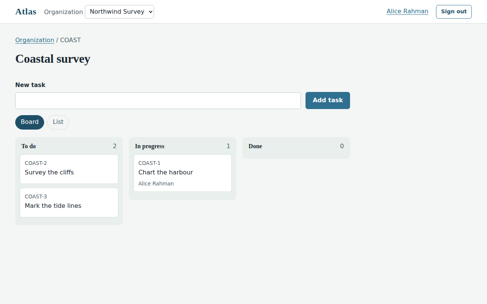
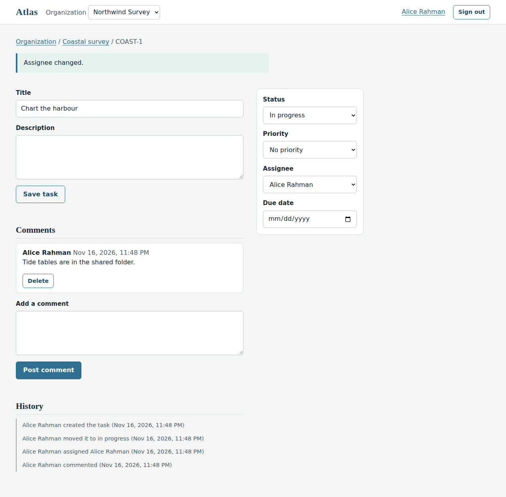
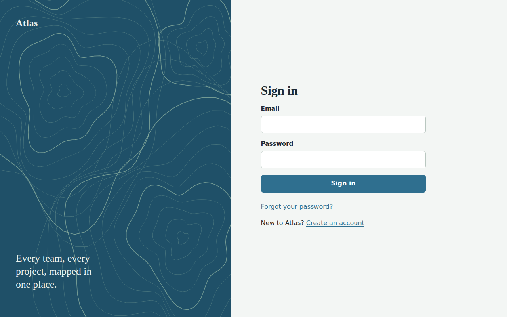

# Atlas

Atlas is a multi-tenant workspace where teams organize their work. Many
organizations share one application and database, and none can see another's
data: that guarantee is enforced in the API on every request and again by
constraints inside PostgreSQL, and both layers are attacked by automated tests
on every change.

**Status:** milestones M0 (foundation) and M1 (identity, organizations,
tenancy) are complete; see the [M1 exit report](docs/09-m1-exit-report.md).
M2 (projects and tasks), M3 (views, planning and accessibility), M4
(real-time updates and notifications) and M5 (attachments, search and
analytics) are complete too; see the [M2](docs/10-m2-exit-report.md),
[M3](docs/11-m3-exit-report.md), [M4](docs/12-m4-exit-report.md) and
[M5](docs/13-m5-exit-report.md) exit reports. Not deployed; no
production-readiness claims.

| Task board                                        | Task with comments and history                  |
| ------------------------------------------------- | ----------------------------------------------- |
|  |  |

| Sign in                                   | Organization owner                                       |
| ----------------------------------------- | -------------------------------------------------------- |
|  |  |

## What works today

- **Accounts:** signup with email verification, sign-in, password reset that
  signs out every device, and a list of signed-in devices you can revoke.
- **Organizations:** create, switch, rename; invite people by email; change
  roles; remove members or leave. Admins can never grant or touch admin or
  owner roles, and every organization always keeps an owner.
- **Security:** Argon2id passwords; opaque session tokens stored only as
  HMAC digests in HttpOnly cookies; exact-Origin checks on every write; Redis
  rate limits that fail closed; an append-only audit log written in the same
  transaction as each change.
- **Projects and tasks:** projects with organization-wide or private
  visibility and per-project roles; numbered tasks with status, priority,
  assignee and due date on a board or list; comments; a change history; and
  edit-conflict detection so two people never silently overwrite each other.
- **Views and planning:** custom workflow states; drag-and-drop board with a
  keyboard alternative; list, table and calendar views with filters and
  saved views; task dependencies with loop protection; milestones with
  progress; custom fields (text, number, date, choice list).
- **Real time:** changes by others appear on open boards and task pages
  without reloading (Server-Sent Events fed by a transactional outbox and
  Redis), with replay after a dropped connection; you can see who else is
  viewing a task; assignment and comment notifications in an inbox, and by
  email if unread after two minutes.
- **Files, search and numbers:** attachments uploaded straight to S3-compatible
  storage and held in quarantine until their content is checked; full-text
  search across tasks and comments that never reveals private projects;
  project numbers computed from the task rows; background CSV exports that
  expire after a day.
- **Accessibility:** keyboard shortcuts and a skip link; colour tokens checked
  against WCAG contrast minimums; an axe-core audit of every page the
  browser test visits, at phone, tablet and desktop widths.
- **Isolation:** outsiders get the same 404 as for an organization that does
  not exist; composite foreign keys and triggers stop cross-tenant links even
  if application code is wrong.

**Stack:** TypeScript (strict) monorepo with pnpm and Turborepo; Next.js 16
and React 19; NestJS 11; PostgreSQL 17 with hand-reviewed SQL migrations and
Prisma schema; Redis; Zod; Vitest; Playwright smoke test; GitHub Actions.

**How it is verified:** 145 unit tests and 114 integration tests against real
PostgreSQL and Redis, plus a browser test that drives three users through
signup, invitations, projects, tasks, views, live updates, notifications,
attachments, search and exports, and audits accessibility. Design decisions are recorded as ADRs in
[`docs/adrs`](docs/adrs).

**Owner:** Bader Altemane

## Run it locally

The repository root is this `atlas/` directory. Install Node.js 24 (tested with
24.22.0), pnpm 10.34.9, and Docker Desktop with Linux containers and Compose v2.
If pnpm is missing, install it with `npm install --global pnpm@10.34.9`.

```powershell
Copy-Item .env.example .env
# Edit .env: set POSTGRES_PASSWORD and MINIO_ROOT_PASSWORD to your own values.
# Set DATABASE_URL with the same PostgreSQL password, URL-encoded.
pnpm install --frozen-lockfile
docker compose up -d --build
pnpm db:validate
pnpm db:generate
pnpm db:migrate
pnpm dev
```

Web: [localhost:3000](http://localhost:3000). Open it at exactly the address in
`WEB_ORIGIN`; sign up there and follow the verification link printed in the
API's terminal. The web app proxies `/api/*` to the API (ADR-017). API liveness/readiness:
`http://127.0.0.1:3001/v1/health/live` and `/v1/health/ready`.
Worker exposes the same health routes on port 3002; it processes no jobs yet.
Web liveness is `/health/live`. Readiness returns 503 if PostgreSQL or Redis is
unavailable. Authentication routes live under `/v1/auth` (signup, verify-email,
resend-verification, login, logout, session, password reset and session
management) and are rate limited through Redis; see `contracts/openapi.yaml`
and ADR-011 to ADR-013. Security-relevant actions are written to an
append-only audit log (ADR-014). Organizations live under
`/v1/organizations/{slug}`; membership and role are checked on every request
(ADR-015); members join through email invitations and roles follow a
no-escalation policy (ADR-016). In
development, verification emails are printed to the API console. Set
`SESSION_SECRET` and `WEB_ORIGIN` in `.env` before starting the API.

Mailpit's local inbox is at `http://127.0.0.1:8025` (SMTP 1025), and MinIO uses
9000/9001. These services are development-only. MinIO is built from a pinned
[upstream source release](https://github.com/minio/minio/releases/tag/RELEASE.2025-10-15T17-29-55Z)
because the historical Hub image is no longer a dependable distribution path.
Its Docker build and all Compose image pulls still require verification on a
Docker host. No storage bucket, mail transport or upload workflow is implemented.

`pnpm dev` builds shared packages, then starts all three apps with source watchers.
Restart it after shared-package edits. `.env` stays untracked. Local data persists
in Compose volumes; `docker compose down` stops services without removing data.

```powershell
pnpm format:check
pnpm lint
pnpm typecheck
pnpm test
pnpm build
pnpm smoke:dev # Uses ports 3000/3101/3102; stops its own processes afterwards.
pnpm test:integration # Requires running PostgreSQL/Redis and db:migrate first.
# Browser smoke test with screenshots: runs in CI (.github/workflows/ui-smoke.yml).
pnpm audit --prod --audit-level high
```

The checked-in CI workflow runs these checks and migrates a fresh ephemeral
PostgreSQL database before integration tests. CI itself has not been executed on
GitHub. E2E, seed, Terraform and deployment commands remain future milestones;
they are not implemented scripts. Product design and the full backlog follow.

## Product purpose

Implement a credible, robust, production-oriented collaborative workspace. The baseline requires role-secured organizations, project/task management, real-time collaboration, notifications, configurable workflow automation, search, files, analytics, integration APIs, and operational readiness. Do not confuse a working demo with independently verified production readiness.

## System defaults

- Monorepo: pnpm workspaces + Turborepo; TypeScript strict mode throughout.
- Web: Next.js 16 stable App Router, React, Tailwind CSS, shadcn/ui, TanStack Query, Zod, React Hook Form, dnd-kit, accessible components.
- API: NestJS REST API at `/v1`, OpenAPI 3.1 document, global input validation, explicit service/use-case boundaries.
- Data: PostgreSQL, Prisma ORM and hand-reviewed SQL migrations; UUIDv7/UUID identifiers; UTC timestamptz; database-side constraints.
- Auth: server-side opaque session IDs, hashed at rest, first-party HttpOnly Secure cookies, mandatory verified email for invitations, CSRF defenses and step-up MFA for sensitive operations. No localStorage bearer tokens.
- Real time: NestJS WebSocket gateway with secure short-lived handshake and room-scoped authorization; Redis pub/sub adapter; authoritative change events emitted from outbox after commit.
- Async: BullMQ + Redis; transactional outbox with separately processed dispatcher; idempotency tracking.
- Files: private S3-compatible object storage with short-lived signed transfers and malware scanning pipeline.
- Infra: local Docker Compose; staging/prod AWS via Terraform (ECS Fargate, ALB, RDS PostgreSQL, ElastiCache Redis, S3, CloudFront, Secrets Manager, CloudWatch).
- Quality: ESLint, Prettier, typecheck, unit/integration/E2E, OWASP ASVS 5 mapping, dependency/security scanning, performance and accessibility budgets.

## Documents

- [Product requirements and UX](docs/01-product-and-ux.md)
- [Architecture and technical decisions](docs/02-architecture.md)
- [Relational data and isolation model](docs/03-database.md)
- [API and events](docs/04-api-contract.md)
- [Authentication and security](docs/05-security.md)
- [Infrastructure and operations](docs/06-infrastructure.md)
- [Quality and test strategy](docs/07-quality.md)
- [Milestones, dependencies and acceptance](docs/08-milestones.md)
- [M1 exit report](docs/09-m1-exit-report.md)
- [M2 exit report](docs/10-m2-exit-report.md)
- [M3 exit report](docs/11-m3-exit-report.md)
- [M4 exit report](docs/12-m4-exit-report.md)
- [M5 exit report](docs/13-m5-exit-report.md)
- [Architecture decision records](docs/adrs)
- [Representative OpenAPI contract](contracts/openapi-starter.yaml)

## Engineering nonnegotiables

1. Check organization membership and resource-level permission on _every_ read/write/subscription, with negative cross-tenant tests.
2. No unscoped `findUnique(id)` followed by trusting its result for tenant resources; query within authorized tenant boundary and verify ownership paths.
3. Make database writes and outbox messages atomic; consumers must be retryable and idempotent.
4. Audit authorization-sensitive mutations; never include secrets or sensitive contents in logs.
5. Keep schema, implementation, automated tests, and docs synchronized. Do not mark missing work complete.
6. No fake data or seeded users in production unless isolated demo accounts are intentionally provisioned.
7. Pin dependency versions after verifying supported combinations, and run security advisory checks before deployment.

## Decision precedence

Security and correctness > documented acceptance criteria > maintainable architecture > UX polish > raw feature count. Scope is preserved as backlog rather than silently abandoned.
