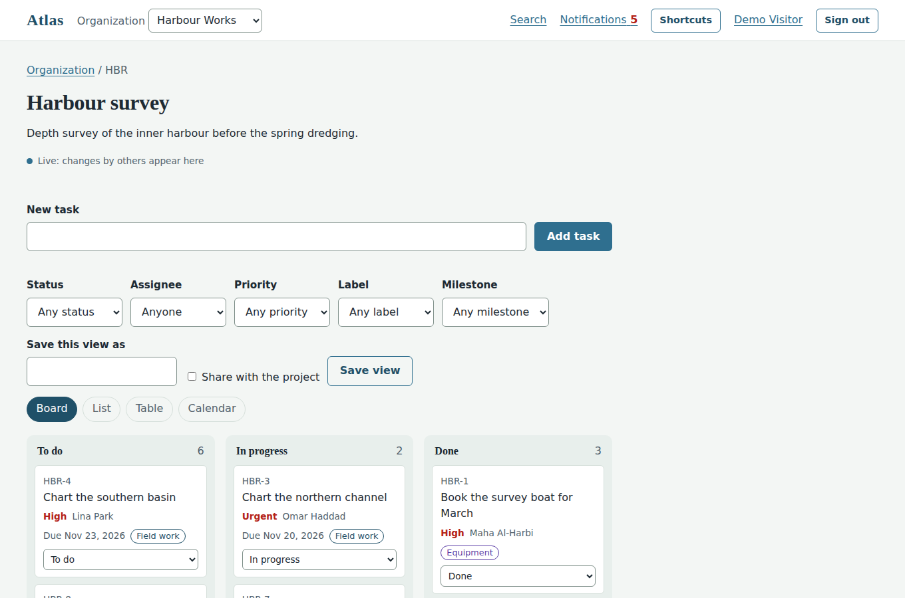
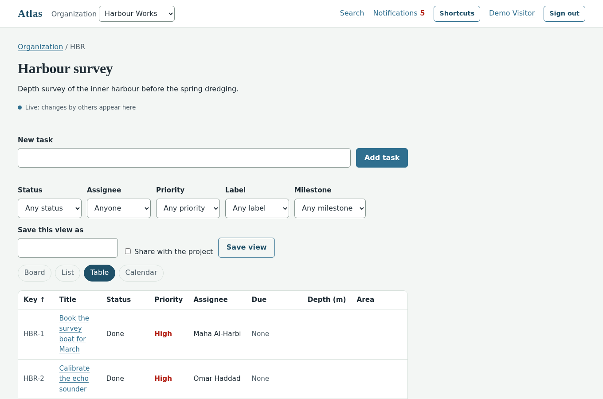
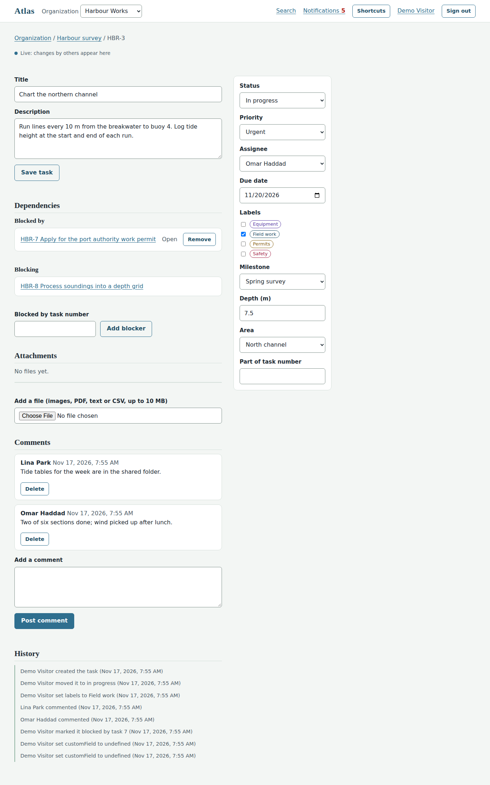
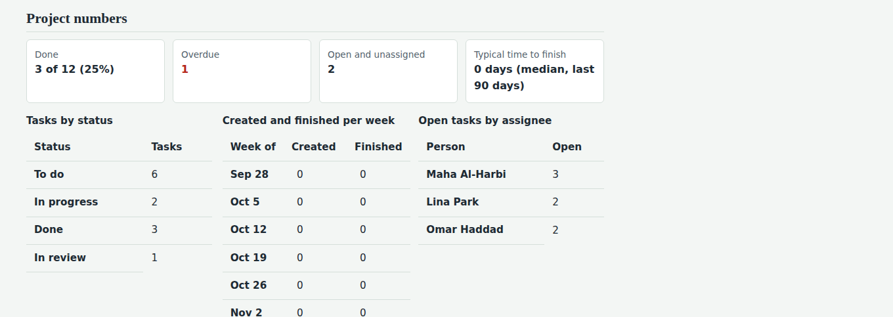
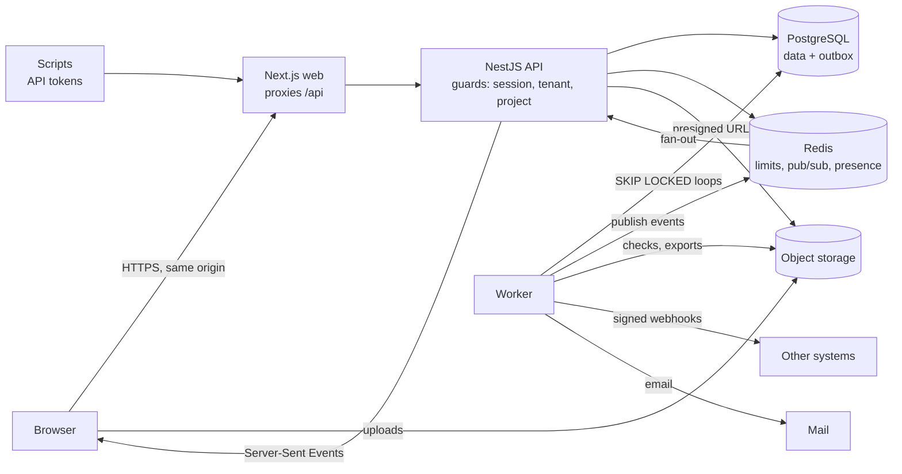

# Atlas

Atlas is a multi-tenant work management app: organizations, projects and
tasks with boards, tables and calendars, live updates, notifications,
search, files, automation rules, webhooks and an API for scripts. Many
organizations share one application and database, and none can see
another's data: the API checks every request, PostgreSQL constraints back it
up, and both are attacked by automated tests on every change.

Built by Bader Altemane as a portfolio project ([case study](docs/18-case-study.md)), milestone by milestone, with
every design decision recorded as an [ADR](docs/adrs) and every milestone
closed by an exit report. **It is not deployed**; the AWS stack is written
and validated but has not been applied, and the limitations are listed in
the [M7 exit report](docs/17-m7-exit-report.md).

| Board with live updates                           | Table with custom fields                              |
| ------------------------------------------------- | ----------------------------------------------------- |
|  |         |
| **Task with dependencies, files and history**     | **Project numbers**                                   |
|       |  |

More: [search](docs/screenshots/demo-search.png),
[task on a phone](docs/screenshots/demo-task-phone.png),
[sign in](docs/screenshots/01-login.png) ([phone](docs/screenshots/15-login-mobile.png)),
[accepting an invitation](docs/screenshots/08-accept-invitation.png),
[members](docs/screenshots/12-member-removed.png),
[signed-in devices](docs/screenshots/14-account-sessions.png).

## Try it in five minutes

With Docker and Node.js 24:

```bash
cp .env.example .env          # set the passwords and SESSION_SECRET
pnpm install --frozen-lockfile
docker compose up -d --build  # PostgreSQL, Redis, MinIO, Mailpit
pnpm db:migrate && pnpm dev   # web on http://localhost:3000
pnpm demo:seed                # prints a sign-in for the demo organization
```

`pnpm demo:seed` creates **Harbour Works**, a fictional team surveying a
harbour: two projects with statuses, labels, milestones, dependencies,
comments, custom fields, an automation rule and a recurring task. Sign in
with the printed account and try:

1. the board: drag a card, or use its move menu with the keyboard;
2. press `?` for keyboard shortcuts, `/` to search ("chart"), `t` for the table;
3. open `HBR-3`: comments, dependencies, custom fields, history, and
   attachments once storage is set up (see `.env.example`);
4. open the same project in a second window and change a task: the first
   window updates live;
5. create an **urgent** task: the automation rule assigns it to Maha and
   labels it Safety within a second;
6. the organization page: invite people, add a webhook, create an API token.

The whole stack also runs in containers:
`docker compose -f docker-compose.yml -f compose.app.yml up --build`.

## What it does

- **Work:** projects (organization-wide or private) with per-project roles;
  tasks with custom statuses, priority, assignee, due date, labels, subtasks,
  dependencies with loop protection, milestones and custom fields; board,
  list, table and calendar views with filters and saved views.
- **Collaboration:** comments, field-level history, live updates over
  Server-Sent Events with replay after a dropped connection, presence,
  notifications in an inbox and by email.
- **Files, search and numbers:** uploads straight to object storage, held in
  quarantine until their content is checked; full-text search in any
  language that never reveals private projects; project analytics; CSV
  exports that expire.
- **Automation and integration:** rules with triggers, conditions and
  actions (with loop protection and a preview), recurring tasks, signed
  webhooks with SSRF protection, scoped API tokens, and
  [examples](examples) of a client and a webhook receiver.
- **Accounts and security:** email verification, password reset and change,
  session management, rate limits, audit log, content security policy; see
  the [security review](docs/15-security-review.md).
- **Accessibility:** keyboard shortcuts and a skip link, WCAG contrast checks
  on the colour tokens, an axe-core audit of every page the browser test
  visits at phone, tablet and desktop widths.

## Architecture



Every change writes its row, a history entry and an outbox event in one
transaction. The worker turns outbox events into live updates, notifications,
webhooks and rule runs, each exactly once or deduplicated by event id. See
[docs/02](docs/02-architecture.md) and the [ADRs](docs/adrs).

## How it is verified

Every pull request runs, on GitHub Actions:

- 187 unit tests and 135 integration tests against real PostgreSQL and
  Redis, including negative tests for every tenant-scoped route;
- a browser test that drives three users through signup, invitations,
  projects, views, live updates, uploads, notifications, search and exports
  at three screen sizes, audits accessibility on every page and records a
  [load baseline](docs/16-load-baseline.md);
- production image builds, Terraform validation, and a release drill that
  upgrades from the previous release, rolls back and restores a backup
  ([ADR-044](docs/adrs/044-m7-release-drill.md)).

Locally: `pnpm format:check`, `pnpm lint`, `pnpm typecheck`, `pnpm test`,
`pnpm build`, and `pnpm test:integration` with PostgreSQL and Redis running.

## Product purpose

Implement a credible, robust, production-oriented collaborative workspace. The baseline requires role-secured organizations, project/task management, real-time collaboration, notifications, configurable workflow automation, search, files, analytics, integration APIs, and operational readiness. Do not confuse a working demo with independently verified production readiness.

## Stack as built

- **Monorepo:** pnpm workspaces and Turborepo, TypeScript strict mode.
- **Web:** Next.js 16 App Router and React 19 with plain CSS on design tokens;
  the original plan named Tailwind and component libraries, but no new
  packages could be added during the build, and the hand-written components
  pass the accessibility audit.
- **API:** NestJS 11 REST at `/v1`, Zod-validated input shared with the web
  app through `@atlas/contracts`, RFC 9457 problem details.
- **Data:** PostgreSQL 17 with hand-written SQL migrations (Prisma schema kept
  in step for validation), composite tenant keys and triggers; Redis for rate
  limits, pub/sub and presence; S3-compatible object storage.
- **Real time:** Server-Sent Events fed by a transactional outbox instead of
  the planned WebSockets ([ADR-029](docs/adrs/029-m4-event-stream.md)).
- **Background work:** worker loops over PostgreSQL with `SKIP LOCKED`
  instead of BullMQ ([ADR-028](docs/adrs/028-m4-outbox-dispatch.md)).
- **Infrastructure:** Docker images, Terraform for AWS (ECS Fargate, ALB, RDS,
  ElastiCache, S3, Secrets Manager, CloudWatch).

## Documents

- [Product requirements and UX](docs/01-product-and-ux.md)
- [Architecture and technical decisions](docs/02-architecture.md)
- [Relational data and isolation model](docs/03-database.md)
- [API and events](docs/04-api-contract.md)
- [Authentication and security](docs/05-security.md)
- [Infrastructure and operations](docs/06-infrastructure.md)
- [Quality and test strategy](docs/07-quality.md)
- [Milestones, dependencies and acceptance](docs/08-milestones.md)
- [M1 exit report](docs/09-m1-exit-report.md)
- [M2 exit report](docs/10-m2-exit-report.md)
- [M3 exit report](docs/11-m3-exit-report.md)
- [M4 exit report](docs/12-m4-exit-report.md)
- [M5 exit report](docs/13-m5-exit-report.md)
- [M6 exit report](docs/14-m6-exit-report.md)
- [Security review](docs/15-security-review.md)
- [Load baseline](docs/16-load-baseline.md)
- [M7 exit report](docs/17-m7-exit-report.md)
- [Runbooks](docs/runbooks)
- [Case study](docs/18-case-study.md)
- [M8 exit report](docs/19-m8-exit-report.md)
- [Architecture decision records](docs/adrs)
- [Representative OpenAPI contract](contracts/openapi-starter.yaml)

## Engineering nonnegotiables

1. Check organization membership and resource-level permission on _every_ read/write/subscription, with negative cross-tenant tests.
2. No unscoped `findUnique(id)` followed by trusting its result for tenant resources; query within authorized tenant boundary and verify ownership paths.
3. Make database writes and outbox messages atomic; consumers must be retryable and idempotent.
4. Audit authorization-sensitive mutations; never include secrets or sensitive contents in logs.
5. Keep schema, implementation, automated tests, and docs synchronized. Do not mark missing work complete.
6. No fake data or seeded users in production unless isolated demo accounts are intentionally provisioned.
7. Pin dependency versions after verifying supported combinations, and run security advisory checks before deployment.

## Decision precedence

Security and correctness > documented acceptance criteria > maintainable architecture > UX polish > raw feature count. Scope is preserved as backlog rather than silently abandoned.
