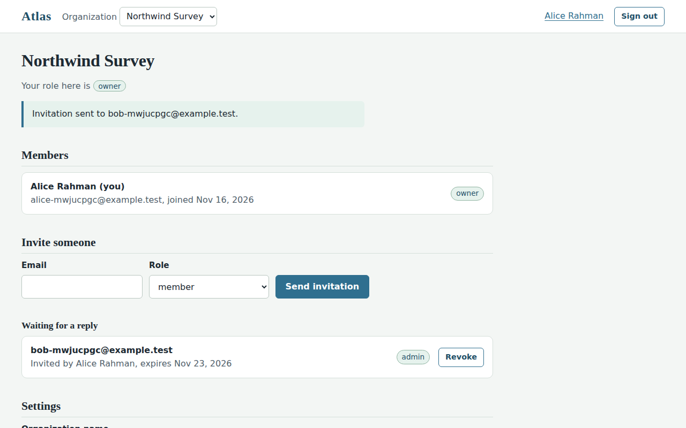
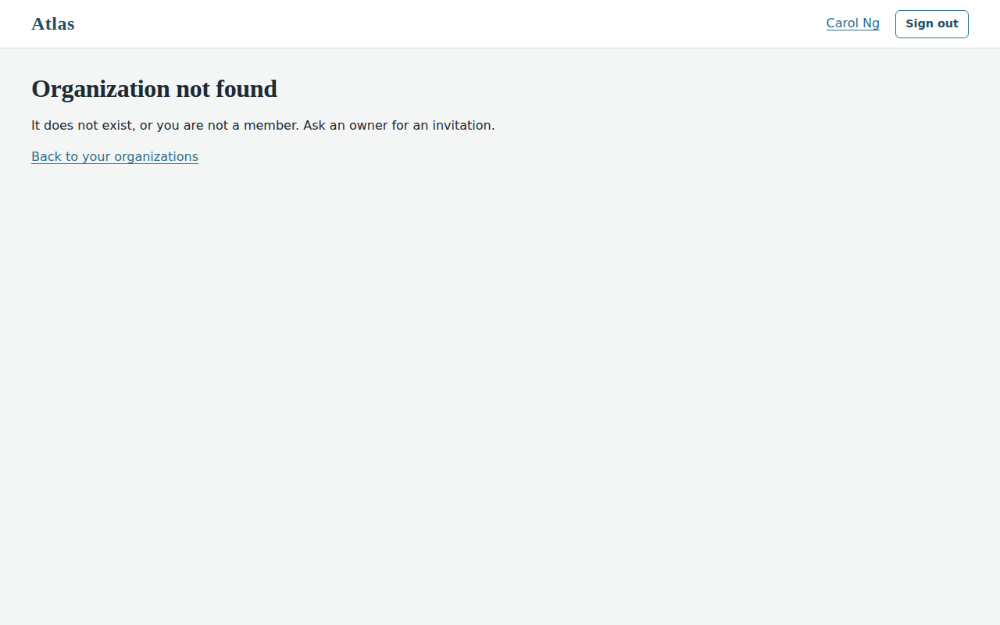

# 09 — M1 Exit Report: Identity, Organizations, Tenancy

**Status:** complete, with the deferrals listed below.
**Date:** 2026-11-17.
**Scope reference:** `docs/08-milestones.md`, M1.

## Exit criteria and evidence

Every item is verified by automated tests that run in CI on each pull request
against a freshly migrated PostgreSQL 17 database and Redis.

| Exit criterion                                                          | Evidence                                                                                                                                                                                                                                                                               |
| ----------------------------------------------------------------------- | -------------------------------------------------------------------------------------------------------------------------------------------------------------------------------------------------------------------------------------------------------------------------------------- |
| 2 organizations and 3 accounts demonstrate isolation and allowed access | `tests/integration/organizations.test.ts` (owner, outsider and a member whose role changes across guest, member, admin and suspended); `tests/integration/invitations.test.ts` (cross-organization member ids return 404); browser smoke test (outsider sees "Organization not found") |
| Permission and CSRF negative tests pass                                 | `tests/organization-policy.test.ts` pins the role × action matrix and no-escalation rules; `invitations.test.ts` covers admins trying to create, change or remove admins and owners; `auth-flow.test.ts` rejects writes from a foreign or missing Origin                               |
| Owner preservation is transactional                                     | `tests/integration/identity-tenancy.test.ts` (database trigger rejects removing, demoting or suspending the last owner; transfer inside one transaction succeeds); `invitations.test.ts` (API returns 409, ownership transfer works)                                                   |
| Audit entry for sensitive changes                                       | `tests/integration/audit-log.test.ts` (account events, append-only enforcement); `organizations.test.ts` and `invitations.test.ts` assert `org.created`, `org.updated`, `org.invitation.created` and `org.member.joined` records                                                       |
| Login, invite and membership removal usable in the UI                   | `.github/workflows/ui-smoke.yml` drives Chrome through signup, verification, sign-in, organization creation, invitation, acceptance after signing in, removal (the removed member loses access on the next page load) and the account sessions page                                    |

## The isolation demo

The browser smoke test is the demo, and it runs on every change:

1. **Alice** signs up, verifies her email, signs in and creates
   "Northwind Survey". She is its owner.
2. Alice invites **Bob** as an admin. Bob opens the emailed link while signed
   out, signs in, returns to the invitation and accepts it.
3. **Carol** has her own account but no invitation. Opening Northwind's URL
   shows "Organization not found", exactly what a nonexistent organization
   shows.
4. Alice removes Bob. Bob's next page load shows "Organization not found".

The same isolation is enforced twice: by `TenantGuard` on every API request
(ADR-015) and by composite foreign keys, immutable tenant keys and the
last-owner trigger in PostgreSQL (ADR-010). Integration tests attack both
layers directly.

| Owner with a pending invitation                          | Outsider                                                         |
| -------------------------------------------------------- | ---------------------------------------------------------------- |
|  |  |

## What M1 delivered

| Area                        | Delivered                                                                                                 | Decision record |
| --------------------------- | --------------------------------------------------------------------------------------------------------- | --------------- |
| Identity and tenancy schema | Users, sessions, tokens, organizations, memberships, invitations; database-enforced tenancy rules         | ADR-010         |
| Accounts and sessions       | Signup, email verification, login, logout; Argon2id; opaque HMAC-digested sessions; Origin-checked writes | ADR-011         |
| Abuse protection            | Redis rate limits per address and per account; fail closed                                                | ADR-012         |
| Recovery                    | Password reset that signs out every device; session list and revocation                                   | ADR-013         |
| Audit                       | Append-only `audit_events` written in the same transaction as each change                                 | ADR-014         |
| Organizations               | Create, list, view, rename; `TenantGuard`; deny-by-default permission matrix                              | ADR-015         |
| Membership                  | Email-bound invitations, role changes without escalation, removal, leaving, ownership transfer            | ADR-016         |
| Web application             | Pages for all of the above behind a same-origin API proxy; browser smoke test                             | ADR-017         |

**Test totals at exit:** 51 unit tests, 55 integration tests and one
browser smoke test covering 15 screens.

## Deferred, with reasons

| Item from the M1 plan                        | Status and reason                                                                                                                                                        |
| -------------------------------------------- | ------------------------------------------------------------------------------------------------------------------------------------------------------------------------ |
| Anti-CSRF token                              | Deferred. Exact Origin checks, SameSite cookies, a single origin and JSON-only writes already block cross-site requests (ADR-017). Reconsider with the M3 design system. |
| Project-scoped authorization abstraction     | Moves to M2, where projects exist. The organization policy table and guard are built to extend to project roles.                                                         |
| Request instrumentation (request IDs)        | Deferred to M7 observability; audit events will gain a request id then.                                                                                                  |
| Step-up authentication for sensitive actions | Deferred until MFA exists (docs/05 roadmap).                                                                                                                             |
| Real email delivery                          | Development console transport only; the outbox email worker arrives in M4. Production refuses to start the transport.                                                    |
| Trusted-proxy client addresses               | Required before any deployment: behind the web proxy every request appears to come from one address, so per-address limits are shared (ADR-017).                         |
| Tailwind / shadcn/ui                         | Plain CSS for now; the dependency could not be added in this change. Revisit with the M3 design system.                                                                  |

## Known limitations

- No production deployment exists; nothing here claims production readiness.
- The browser smoke test runs on GitHub's Linux runners in Chrome only.
- Docker Compose services have not been run on the owner's development
  machine; CI provides PostgreSQL and Redis for every test run.

## Next: M2

Projects, workflows, tasks, comments and activity, built on the same tenant
guard and audit patterns, with project-level roles added to the policy
matrix.
